# Project Plan

## Metadata
| Key | Value |
| --- | --- |
| ID | PP-001 |
| CrossReference | [BC-001], [SA-001], [MIL-001], [MIL-002], [MIL-003], [MIL-004] |
| Language | en |
| Domain | it |

## Version History
| Date | Status | Author | Reviewer | Change | Commit |
| --- | --- | --- | --- | --- | --- |
| 2026-11-04 | Deprecated | Jens Tirsvad Nielsen | S01 (AI as stand-in) | Initial version | pending |
| 2026-11-04 | Accepted | Jens Tirsvad Nielsen | S01 (AI as stand-in) | Accepted on RC-003 (Go)<br>Mode: autonomous, not independent | pending |

---

## Purpose

Schedule the four phases that deliver the Instagram follower bot within the Business Case constraints (Python 3.13 or newer, one branch and pull request per milestone).

## Planning Assumptions

- Week 1 starts 2026-11-04 and the plan ends by 2026-11-07 (source: the user prompt asks for milestones with a branch each; the dates are the AI proposal accepted by S01 in chat).
- One phase per day; each phase is one branch and one pull request (source: [BC-001] Constraints).
- Tasks are plain technical tasks (`No` in the use-case column): the assignment is a single goal whose steps the lecture gives, so no separate use case or user story is modelled.

## Gateway Schedule

| Gateway | Document | Window | Decision date | Owner | Stories | Main deliverable | Milestone |
| --- | --- | --- | --- | --- | --- | --- | --- |
| Project setup | [MIL-001] | 2026-11-04 | 2026-11-04 | S01 | none (technical tasks) | Config, tooling, README skeleton, repo metadata | not yet synced |
| Follower bot | [MIL-002] | 2026-11-05 | 2026-11-05 | S01 | none (technical tasks) | InstaFollower bot, tests, Doxygen comments | not yet synced |
| README and screenshots | [MIL-003] | 2026-11-06 | 2026-11-06 | S01 | none (technical tasks) | README with run/test steps and 5 screenshots | not yet synced |
| Wiki | [MIL-004] | 2026-11-07 | 2026-11-07 | S01 | none (technical tasks) | Wiki in en, da, ms with screenshots | not yet synced |

```plantuml
@startgantt
Project starts 2026-11-04
[Project setup] starts 2026-11-04 and ends 2026-11-04
[Follower bot] starts 2026-11-05 and ends 2026-11-05
[README and screenshots] starts 2026-11-06 and ends 2026-11-06
[Wiki] starts 2026-11-07 and ends 2026-11-07
[MIL-001 Go/No-Go] happens 2026-11-04
[MIL-002 Go/No-Go] happens 2026-11-05
[MIL-003 Go/No-Go] happens 2026-11-06
[MIL-004 Go/No-Go] happens 2026-11-07
@endgantt
```



## Scope Coverage

| Business Case scope item | Gateway |
| --- | --- |
| Python 3.13, venv, pyproject, .gitignore, Doxyfile | [MIL-001] |
| Git host description and topics | [MIL-001] |
| Selenium bot, pytest tests, Doxygen comments | [MIL-002] |
| README and screenshots | [MIL-003] |
| Wiki in en, da, ms | [MIL-004] |

## Dependencies

```
MIL-001 → MIL-002 → MIL-003 → MIL-004
```

A No-Go on a phase stops the later phases until it is fixed and re-reviewed, and each later date moves by the days lost. S01 decides any move of the end date 2026-11-07.

## Plan Risks

| Risk | Impact | Mitigation |
| --- | --- | --- |
| Share-a-Naan needs the owner login for screenshots (Business Case risk: layout or login differs from the lecture) | MIL-003 and MIL-004 blocked | Stop and report; resume when credentials are provided in the environment |
| The wiki is not enabled on the host | Wiki not visible | Check at MIL-004 and report |
| The git host token lacks a scope (Business Case risk: token handling) | Metadata or issues fail | Report which call failed; never print the token |

## Open Issues

- The `origin` path is `Tirsvad-Udemy-100-days-of-code/052-instagram-followers`; the prompt names `Tirsvad-Udemy-100_days_of_code`. The existing `origin` is used unless the user says otherwise.
- Share-a-Naan selectors are unknown until the page is inspected; locators are verified in MIL-002 and MIL-003.

---

[BC-001]: ./business-case.md
[SA-001]: ./stakeholder-analysis.md
[MIL-001]: ./milestones/mil-001-project-setup.md
[MIL-002]: ./milestones/mil-002-follower-bot.md
[MIL-003]: ./milestones/mil-003-readme-and-screenshots.md
[MIL-004]: ./milestones/mil-004-wiki.md
